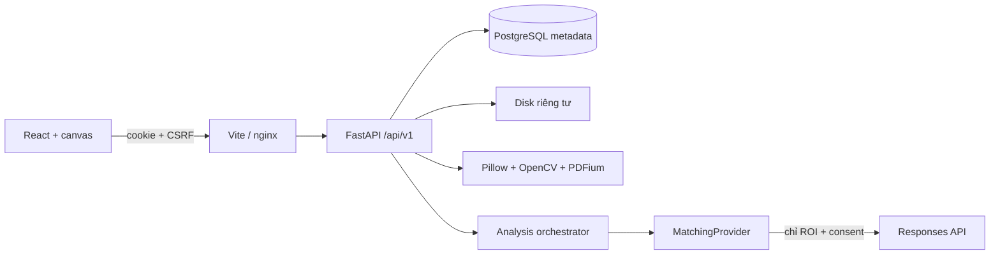

# Kiến trúc

Modular monolith. React Router điều hướng; TanStack Query quản lý dữ liệu server; React Hook Form/Zod xác thực login. Button theo cấu trúc shadcn/ui dùng Radix Slot/CVA. Tailwind v4/CSS token có sáng/tối, desktop 1366×768 và tablet. Canvas SVG chọn/di chuyển/resize ROI theo tọa độ nguồn, độc lập CSS zoom.

FastAPI tách API, Pydantic schemas, services, SQLAlchemy models và repositories. Psycopg v3 đồng bộ nhất quán; xử lý CPU trong thread pool, orchestrator async chờ OpenAI. Giao dịch ngắn, không giữ lock qua network request. SELECT FOR UPDATE bảo vệ chuyển trạng thái running. Mỗi kết quả commit riêng, giữ kết quả đầu nếu K sau lỗi.

`MatchingProvider.analyse(MatchInput) -> MatchOutput` là giao diện thay thuật toán. Registry chỉ có openai_vision. ICP/Siamese/ensemble ném NotImplementedError, không được chọn. Protocol detect/segment/register/extract/retrieve/classify/calibrate/report xác định ranh giới mở rộng.

Tích hợp đối chiếu [Images and Vision](https://developers.openai.com/api/docs/guides/images-vision), [Structured Outputs](https://developers.openai.com/api/docs/guides/structured-outputs), [File inputs](https://developers.openai.com/api/docs/guides/file-inputs), [GPT-4.1](https://developers.openai.com/api/docs/models/gpt-4.1), và chữ ký SDK đã cài. Dùng AsyncOpenAI.responses.parse(text_format=SealVisualComparison), hai input_image PNG data URL, store=False, không tools web. Không gửi PDF trực tiếp. Model từ .env, không ép temperature/reasoning/detail tùy tiện. SDK tối đa 2 retry có backoff, timeout ngoài giới hạn tổng mỗi cặp. Lưu request ID, usage, duration; không bịa giá.

Luồng: upload → kiểm tra bytes → file UUID → chọn trang → crop/pipeline → PNG/run → Q/K → session/candidates → consent → result append-only → annotation user → HTML report.

PDFium có lock process vì không thread safe, page/bitmap đóng sau render. Preview và apply cùng service; mask overlay chỉ tô preview. Debounce/hủy ở frontend; backend xử lý ảnh gốc rồi thu nhỏ preview để giữ thông số nhất quán.

V2 có thể đưa orchestrator vào worker queue, API 202 và frontend polling; schemas/candidates/results giữ được. V1 request chờ kết quả; mất trình duyệt không đảm bảo hủy upstream đã tiếp nhận. Frontend không tự gọi lại để tránh phí ngoài ý muốn.

Nếu tiến trình bị dừng đột ngột, phiên running chỉ được cho chạy lại sau cửa sổ timeout tối đa cho cả danh sách K cộng 120 giây. Thao tác phục hồi có audit. V1 chưa có worker heartbeat hoặc trạng thái hủy bền vững; mọi result đã commit vẫn còn.
